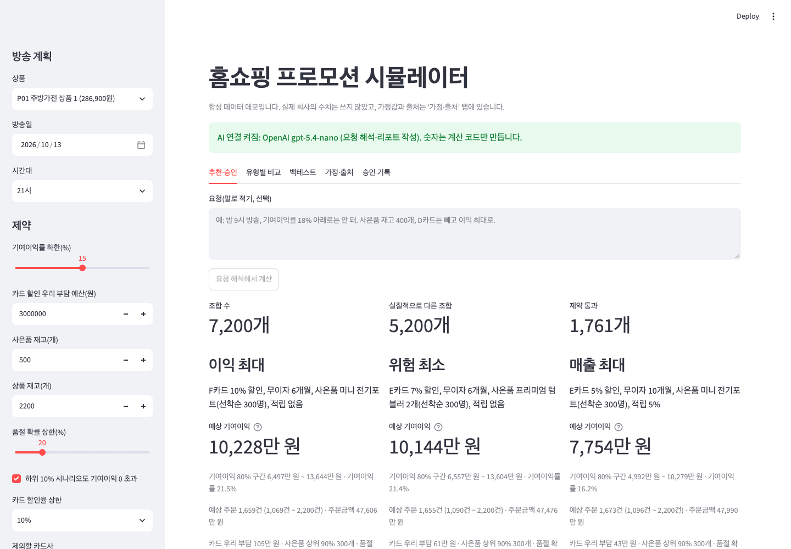
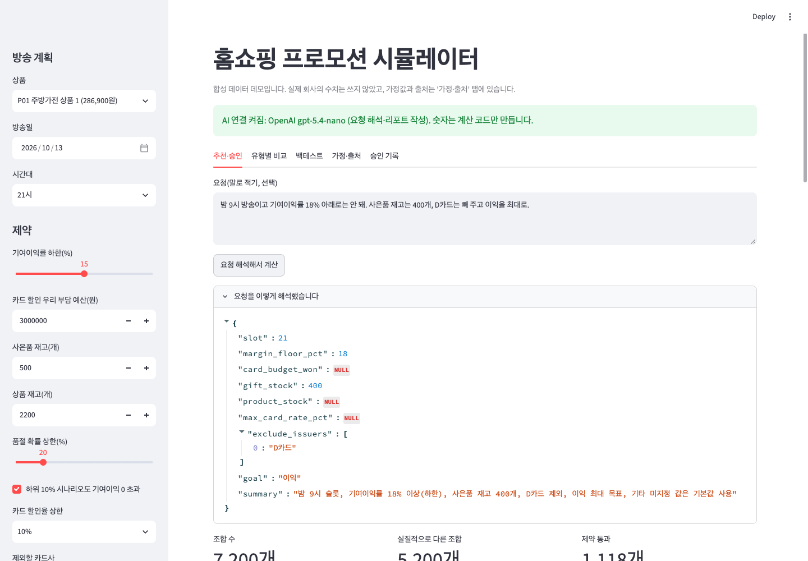
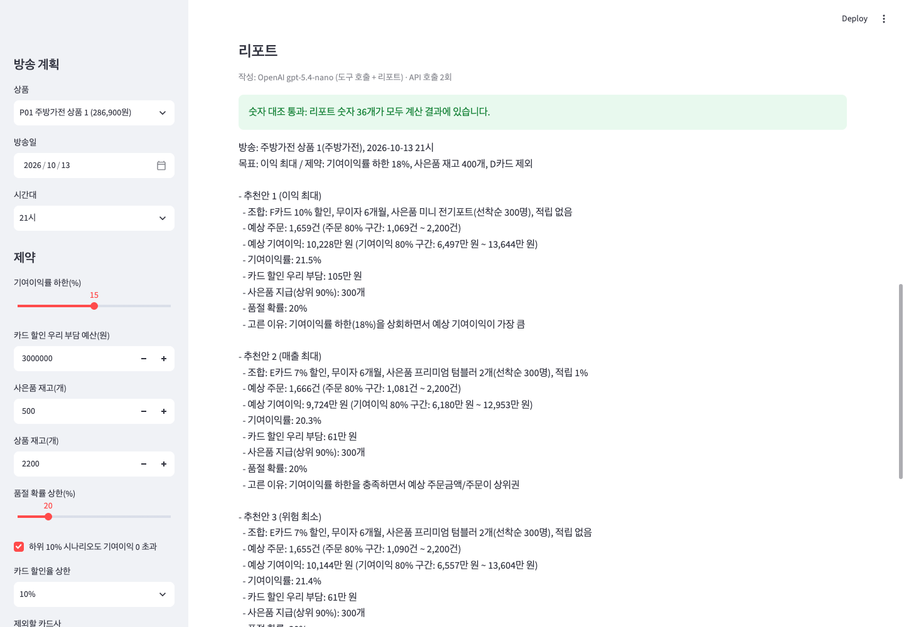
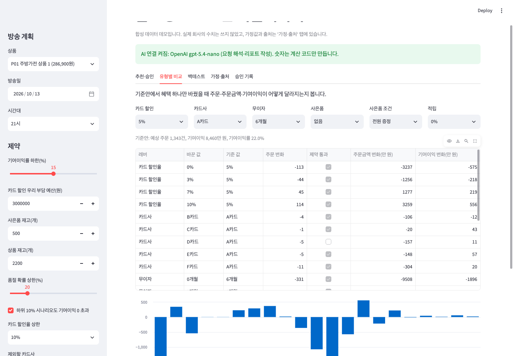
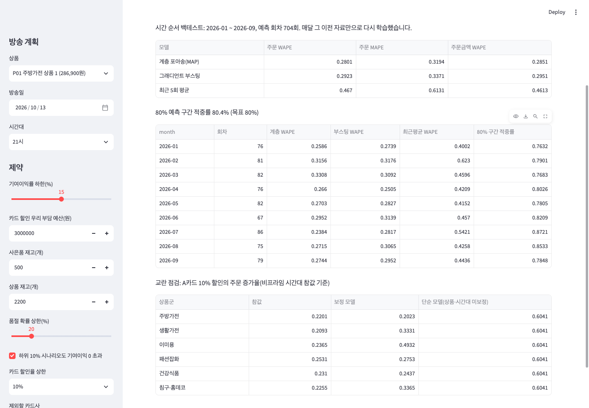

# 홈쇼핑 프로모션 시뮬레이터 (합성 데이터 데모)

방송 한 회차에 붙일 혜택(카드 할인, 카드사, 무이자 할부, 사은품, 사은품 조건, 적립금) 조합 7,200개를 계산해
예상 주문·주문금액·기여이익과 80% 구간을 내고, 제약(기여이익률 하한, 카드 할인 부담 예산, 사은품 재고, 품절 확률)을
지키는 추천안 3개(이익 최대·매출 최대·위험 최소)를 담당자 승인 화면에 올리는 에이전트 프로토타입입니다.

데이터는 모두 합성입니다. 실제 회사의 수치는 하나도 쓰지 않았고, 가정값마다 출처나 "임의 설정"을 적었습니다.



## 구조

```
담당자 요청(말 또는 화면 입력)
  │
  ▼
조정 에이전트 (promo_sim/agent.py)
  ├ OPENAI_API_KEY 있음: OpenAI Responses API 함수 호출 → run_simulation 도구 호출 → 리포트 작성
  └ 없음/실패: 규칙 해석기 → 같은 도구 → 틀 리포트
  │
  ├─ 수요 반응 모델 (promo_sim/model.py)   계층 포아송 회귀(MAP) + 음이항 예측 구간, 구간 폭 보정
  ├─ 조합 계산·제약 (promo_sim/simulate.py) 7,200개 x 400개 시나리오(공통 난수), 기여이익 계산식, 제약 걸러내기
  ├─ 리포트·숫자 대조 (promo_sim/report.py) 리포트의 모든 숫자를 계산 결과와 대조, 하나라도 없으면 틀 리포트로 교체
  └─ 사람 승인 (app.py)                    승인·수정 요청·반려 기록(data/approvals.jsonl), 자동 집행 없음
```

원칙: 언어 모델은 숫자를 만들지 않습니다. 예측·계산·최적화는 파이썬 코드가 하고(시드 고정), 언어 모델은 요청 해석과 설명만 합니다.

## 실행

```bash
python3.12 -m venv .venv
.venv/bin/pip install -r requirements.txt
.venv/bin/python -m pytest -q              # 테스트 20개
.venv/bin/python scripts/run_backtest.py   # 백테스트(수십 초) → docs/backtest.md, docs/backtest.json
.venv/bin/streamlit run app.py             # 화면
```

### OpenAI 연결(선택)

- 키는 저장소 루트의 `.env`에 `OPENAI_API_KEY=...`로 넣습니다(`.env.example` 참고). `.env`는 `.gitignore`에 있어 올라가지 않습니다.
- 키가 없으면 AI 연결은 꺼지고, 규칙 해석과 틀 리포트로 계산·추천·승인이 모두 그대로 동작합니다.
- 기본 모델은 `gpt-5.4-nano`(작고 싼 모델)이고 `.env`의 `OPENAI_MODEL`로 바꿀 수 있습니다.
- 요청 한 번에 API 호출은 2회(도구 호출 1회 + 리포트 1회)입니다.
- OpenAI 대시보드에서 프로젝트 월 사용 한도를 5~10달러로 걸어 두기를 권합니다. 공개 데모로 띄울 때는 키 없이 띄우는 것을 권합니다.

## 결과 (합성 데이터, `docs/backtest.md`)

시간 순서 백테스트: 2026-01부터 한 달씩, 그 달 이전 자료만으로 다시 학습해 그 달을 예측했습니다(예측 회차 704회).

| 모델 | 주문 WAPE | 주문 MAPE | 주문금액 WAPE |
|---|---:|---:|---:|
| 계층 포아송(MAP) | 28.0% | 31.9% | 28.5% |
| 그래디언트 부스팅(기준선) | 29.2% | 33.7% | 29.5% |
| 최근 5회 평균(기준선) | 46.7% | 61.3% | 46.1% |

- 80% 예측 구간 적중률 80.4%(목표 80%).
- 참값 평균으로 예측해도 같은 기간 주문 WAPE는 26.9%입니다. 남은 오차 대부분은 방송마다 생기는 우연한 변동입니다.
- 교란 점검: 과거 기록은 프라임 시간대·인기 상품에 큰 할인이 몰리도록 만들었습니다. 상품·시간대를 넣지 않은 단순 모델은 A카드 10% 할인의 주문 증가율을 60.4%로 봤고(참값 20.9~25.3%), 보정 모델은 20.2~49.3%로 참값에 더 가깝습니다. 이미용·침구·생활가전은 아직 과대 추정이 남아 있습니다.
- 무이자·사은품 효과는 상품군별 기울기를 대부분 ±0.1 안에서 되찾았습니다(건강식품 무이자 -0.07 vs 참값 0.05 등 예외는 표 참고).
- 요청 해석 정확도: 틀로 만든 테스트 문장 100개(`tests/parser_cases.jsonl`)에서 규칙 해석기 100%. AI 해석(`gpt-5.4-nano`)은 앞 10문장에서 문장 단위 90%, 항목 단위 98.8%(`scripts/eval_parser.py --ai --limit 10 --out docs/parser_eval_ai.json`, 2026-10-28 실행 결과 `docs/parser_eval_ai.json`). 테스트 문장은 정해진 문구 틀로 만든 것이라(`scripts/make_parser_cases.py`) 규칙 해석기 100%는 그 틀 기준입니다(`docs/parser_eval_rules.json`).

## 화면

| 추천·승인 | 리포트와 숫자 대조 | 유형별 비교 | 백테스트 |
|---|---|---|---|
|  |  |  |  |

## 가정과 출처

| 가정 | 근거 |
|---|---|
| 상품군 판매수수료율 24~33% | 공정거래위원회 2025년 대형유통업체 판매수수료율 등 실태조사(2024년 거래 기준, 2025-12 발표) 보도의 TV홈쇼핑 실질수수료율 27.7% 주변에 상품군 편차를 임의로 둠. [MTN](https://news.mtn.co.kr/news-detail/2025122513185560099), [아시아경제](https://view.asiae.co.kr/article/2025122514260320018). 공정위 보도자료 원문 대조는 남음 |
| 가격탄력성 -1.8 ~ -3.4 | Bijmolt, van Heerde & Pieters (2005), Journal of Marketing Research 42(2): 81개 연구 1,851개 탄력성 평균 -2.62. [초록](https://repository.tilburguniversity.edu/items/813834f9-4626-45f8-ad0a-2920a545e089) |
| 시간대·요일 효과, 카드사 결제 비중·분담률, 사은품 가치·원가, 무이자 수수료, 반품률, 협력사 분담, 산포 | 임의 설정(공개 근거 없음). `promo_sim/assumptions.py` |

## 기여이익 계산식 (`promo_sim/simulate.py`)

```
실질 할인 d = 카드 할인율 x 해당 카드 결제 비중
반품률 = 상품군 기본 반품률 + 0.5 x (d + 적립률)
순주문 = min(주문, 재고) x (1 - 반품률)
기여이익 = 수수료율 x 가격 x 순주문
        - 카드 할인액 x (1 - 카드사 분담) x (1 - 협력사 분담)
        - 무이자 수수료 x (1 - 협력사 분담)
        - 사은품 지급 수 x 원가 x (1 - 협력사 분담)
        - 적립률 x 가격 x 순주문
```

## 한계

- 합성 데이터라 성능 수치는 방법이 작동하는지 보는 용도입니다. 실제 데이터에서는 오차가 더 클 수 있습니다.
- 데이터를 만든 식과 모델 특성이 비슷한 형태라 모델에 유리합니다. 일부러 모델에 없는 효과(프라임 시간대에서 카드 할인 표시 효과가 더 큼)를 넣어 두었습니다.
- 모델의 파라미터 불확실성은 구간에 넣지 않고, 학습 기간 끝 20%로 구간 폭을 보정해 대신합니다.
- 여러 방송을 한 번에 편성하는 최적화, 다음 방송 수요 잠식의 주 단위 합계 비교는 아직 없습니다.
- 카드사·협력사 분담 구조는 계약마다 달라 실제 데이터로 바꿔야 합니다.

## 파일

```
app.py                  Streamlit 화면
promo_sim/assumptions.py 가정값과 출처
promo_sim/levers.py     혜택 항목과 7,200개 조합
promo_sim/data.py       합성 데이터 생성기(참값 효과 숨김)
promo_sim/model.py      계층 포아송(MAP), 기준선 2개, 단순 모델
promo_sim/simulate.py   조합 계산, 제약, 추천, 레버별 비교
promo_sim/report.py     사실표, 틀 리포트, 숫자 대조
promo_sim/agent.py      조정 에이전트(OpenAI 함수 호출 / 규칙 해석)
promo_sim/backtest.py   시간 순서 백테스트, 교란 점검
scripts/                데이터 저장, 백테스트, 해석 채점, 테스트 문장 생성
tests/                  단위·통합·목(mock) 테스트
data/                   합성 데이터(시드 7)
docs/                   백테스트 결과, 화면 캡처
```
